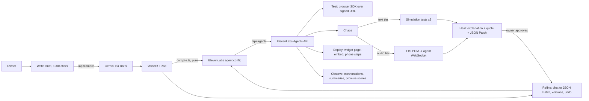

# VaniForge

A web studio where a business owner describes a voice agent in plain English or Hindi, and VaniForge generates, tests, refines, deploys and monitors a real ElevenLabs voice agent. Its differentiator is a **chaos + heal loop**: synthetic callers attack the agent, failures are explained in plain words with the quoted line, VaniForge proposes a JSON Patch fix, the owner approves, and the caller runs again.

Built for Build Arena 2026, problem statement 2 (Team Short Circuit). Hero use case: **Smile Dental, Noida** (fictional).

> First run against live ElevenLabs and Gemini on 29 Oct 2026: see the results section of [`VERIFY.md`](VERIFY.md) for what was checked, what was not, and what it cost. All unit tests pass without keys.
>
> The ElevenLabs key must allow: ElevenLabs Agents (Write), Text to Speech, Speech to Text, Voices (Read), Pronunciation Dictionaries (Write), User (Read). Otherwise every call fails with `missing_permissions`, and the app says which permission is missing.

## Setup

```bash
npm install
cp .env.example .env.local   # then paste your keys (the file is git-ignored)
npm run check-env            # which variables are set; never prints values
npm run smoke                # creates and deletes a throwaway agent; places no call
npm run dev                  # http://localhost:3000
```

| Variable | Notes |
|---|---|
| `ELEVENLABS_API_KEY` | server only |
| `GEMINI_API_KEY` | server only; fictional data only, the free tier may train on prompts |
| `GEMINI_MODEL` | default `gemini-2.5-flash` |
| `OWNER_TRANSFER_NUMBER` | optional, E.164. If empty the transfer tool is omitted and the UI says "transfer number not set" |

Keys are read only in route handlers and scripts. The browser connects with signed URLs minted by `/api/signed-url`.

## Scripts

| Script | What it does | Credits |
|---|---|---|
| `npm run dev` / `build` / `start` | Next.js | 0 |
| `npm run typecheck` / `lint` / `test` | quality gates, tests need no keys | 0 |
| `npm run check-env` | which env vars are set | 0 |
| `npm run smoke` | voices, dictionary, agent create/delete, signed URL, balance. No audio call | about 0 |
| `npm run seed` | creates the Smile Dental agent and runs one text-tier chaos pass | text simulations |
| `npm run audio-chaos -- <agentId> [personaId...]` | audio tier from the terminal | real call time |

## Architecture



Storage is JSON files under `data/` (git-ignored): `agents/<id>/v1.json...`, `meta.json`, `chaos/<id>/<run>.json`, `audio/<hash>.pcm` (cached persona TTS), `cache/compile/`, `settings.json`.

The UI follows the team's v2 deck (paper, ink, signal orange, graphite; Inter Tight, Inter, JetBrains Mono; see section 7 of `CLAUDE.md`). Fonts are bundled in `src/fonts/`; the hero figure is `public/hero/plate-5-3.png`, generated from a Chladni plate equation.

Key files: `src/lib/voiceir.ts` (schema), `compile.ts` (pure VoiceIR to agent config), `llm.ts` (all Gemini calls), `eleven.ts` (all ElevenLabs calls), `personas.ts`, `chaos.ts`, `text-chaos.ts`, `audio-chaos.ts`, `heal.ts`, `credits.ts` (guard), `patch.ts` and `versions.ts` (JSON Patch and undo).

## ElevenLabs capabilities used and where

| Capability | Where |
|---|---|
| Agents API: create, update, delete | `createAgent`, `updateAgent`, `deleteAgent` in `src/lib/eleven.ts`; used by `src/lib/service.ts` |
| Agent config: prompt, first message, languages, Hinglish mode, language presets, TTS model, built-in tools (end call, transfer to number, language detection), turn and ASR settings, max duration | `src/lib/compile.ts` |
| Evaluation criteria generated from every promise | `buildEvaluationCriteria` in `compile.ts`; read back in Observe and the audio tier |
| Signed URL + browser SDK `@elevenlabs/react` | `/api/signed-url`, `src/components/studio/TestTab.tsx` |
| Agent WebSocket (audio chunks in, `user_transcript` / `agent_response` / `interruption` / `ping` out) | `src/lib/audio-chaos.ts` |
| Scribe v2 speech-to-text | `/api/transcribe`, mic button on the Write screen |
| Text to speech (`pcm_16000`, `eleven_flash_v2_5`, cached) | `ttsPcm16k` in `eleven.ts`, audio tier personas |
| Voices (search, labels, previews) | `/api/voices`, voice picker, persona voice choice |
| Agent tests: simulation tests + run tests + invocations | `createSimulationTest`, `runTests`, `waitForInvocation` in `eleven.ts`; `src/lib/text-chaos.ts` |
| Interruption-ignore terms, ASR keywords (Heal) | `speech` block in VoiceIR, mapped in `compile.ts` |
| Pronunciation dictionary (alias rules) | `createPronunciationDictionary` in `eleven.ts`, attached by `service.ts` |
| Conversations list and get, analysis (summary, per-promise results) | `/api/conversations`, Observe tab |
| Convai widget | `/a/[agentId]`, Deploy tab snippet |
| Subscription / credits | `getCredits`, header badge, credit guard |
| Structured procedures | **not used** (stretch goal, not attempted) |

## What is not done

- No phone number is connected. The Deploy tab documents Twilio/Exotel steps and shows a disabled "not connected" button.
- Webhook tools exist in the VoiceIR enum but are ignored by `compile`.
- Procedures (structured pain-to-transfer flow) are not used; the rule lives in the prompt and the transfer tool.
- Observe totals are computed from the latest 30 conversations only.

See [`DECISIONS.md`](DECISIONS.md) for judgment calls and [`VERIFY.md`](VERIFY.md) for the key-gated checklist.
