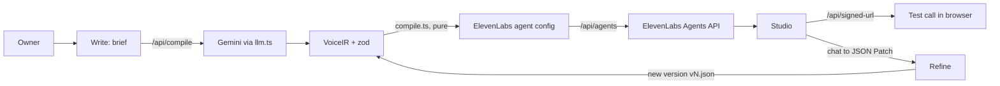

# VaniForge

A web studio where a business owner describes a voice agent in plain English or Hindi, and VaniForge generates, tests and refines a real ElevenLabs voice agent. Built for Build Arena 2026 (Team Short Circuit).

Status: milestones M1 (Write) and M2 (Test + Refine) are built. Chaos + heal, Deploy and Observe are not built yet. See `VERIFY.md` for what still needs API keys to check.

## Setup

```bash
npm install
cp .env.example .env.local   # then paste your keys
npm run check-env            # reports which variables are set, never prints values
npm run smoke                # creates and deletes a throwaway agent; places no call
npm run dev
```

Keys are read only in route handlers and scripts. Nothing secret is ever sent to the browser; calls use signed URLs.

## Scripts

| Script | What it does |
|---|---|
| `npm run dev` / `build` / `start` | Next.js |
| `npm run typecheck` / `lint` / `test` | quality gates (tests need no keys) |
| `npm run check-env` | which env vars are set |
| `npm run smoke` | voices, agent create/delete, signed URL, credit balance, no audio |

## Architecture



Storage is JSON files under `data/` (git-ignored): `agents/<id>/v1.json, v2.json...`, `meta.json`, `settings.json`, `cache/compile/`.

## ElevenLabs capabilities used so far

| Capability | Where |
|---|---|
| Agents API (create, update, delete) | `src/lib/eleven.ts`, `src/lib/service.ts` |
| Signed URL + browser SDK (`@elevenlabs/react`) | `/api/signed-url`, `src/components/studio/TestTab.tsx` |
| Scribe v2 speech-to-text | `/api/transcribe`, mic button on the Write screen |
| Voices (search, previews, labels) | `/api/voices`, voice picker |
| Pronunciation dictionary | `createPronunciationDictionary` in `eleven.ts` |
| Evaluation criteria per promise | `buildEvaluationCriteria` in `compile.ts` |
| Subscription / credits | `getCredits` in `eleven.ts`, header badge |

See `DECISIONS.md` for judgment calls and `VERIFY.md` for the key-gated checklist.
