<p align="center">
  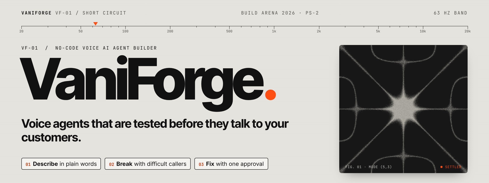
</p>

<p align="center">
  
  
  
  
  
  
  
</p>

<p align="center">
  <a href="#quickstart">Quickstart</a> ·
  <a href="#how-it-works">How it works</a> ·
  <a href="#product-tour">Product tour</a> ·
  <a href="#architecture">Architecture</a> ·
  <a href="#live-results">Live results</a> ·
  <a href="#elevenlabs-inside">ElevenLabs inside</a> ·
  <a href="#status-and-roadmap">Status</a>
</p>

---

**VaniForge** is a no-code studio for voice agents. A shop owner describes the receptionist they need in plain Hindi or English. VaniForge then:

1. builds a real **ElevenLabs** voice agent;
2. **attacks it with difficult synthetic callers**, by text and by real audio;
3. explains each broken promise in plain words, quoting the agent's own line;
4. fixes it with a reviewable JSON Patch once the owner approves;
5. re-runs that caller to prove the fix.

> Built for **Build Arena 2026, problem statement 2: "No-Code Voice AI Agent Builder (ElevenLabs mandatory)"** by **Team Short Circuit**. The hero use case is **Smile Dental, Noida** (fictional): a bilingual receptionist that books appointments, quotes from a price list, hands patients in pain to Dr. Meera Bhatnagar, and never gives medical advice.

## Why

Most voice-bot builders wrap one long prompt and hope. In production that breaks in predictable ways:

| Failure | What happens | What VaniForge does |
| --- | --- | --- |
| **Prompt drift** | Rules, flow and facts sit in one prompt; the model improvises prices or skips a hand-off | Compiles a **typed spec** (VoiceIR) into ElevenLabs config, with every promise scored as an evaluation criterion on every call |
| **Hinglish and accent blindness** | Code-switched speech and Indian names trip speech recognition and TTS | Hindi language preset, Hinglish mode, pronunciation aliases, ASR keywords |
| **Text-only QA** | Simulations type perfectly; real callers pause, mumble and say "haan ji" mid-sentence | An **audio tier** streams synthetic callers into the live agent at phone pace and records what it actually heard |

## How it works

<p align="center">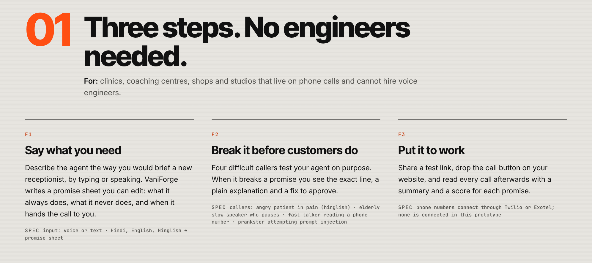</p>

| Step | Owner sees | Under the hood |
| --- | --- | --- |
| **01 Describe** | Types or speaks a brief (≤ 1,000 chars), gets an editable *promise sheet*: Always / Never / Hand off | Scribe v2 → Gemini 2.5 Flash → `VoiceIR` (zod-validated, cached by hash) |
| **02 Create** | Picks a voice, presses Create | Pure compiler `compile.ts` → `agents.create`, pronunciation dictionary, one evaluation criterion per promise |
| **03 Test** | Talks to the agent in the browser: live transcript, latency, interruptions, 90 s countdown | `@elevenlabs/react` over a short-lived **signed URL**; the key never reaches the browser |
| **04 Break** | Four difficult callers, results as *"kept 2 of 3"* per promise | Text tier: ElevenLabs simulation tests × 3. Audio tier: cached TTS → agent WebSocket in real time |
| **05 Heal** | Quoted evidence, a two-sentence explanation, a readable diff, **Approve** | Gemini proposes an RFC 6902 patch; it may never reword the owner's promises; new version → caller re-runs |
| **06 Ship and watch** | Share link, embed snippet, call history with a summary and a score per promise | ElevenLabs widget, conversations API, conversation analysis |

### The chaos + heal loop

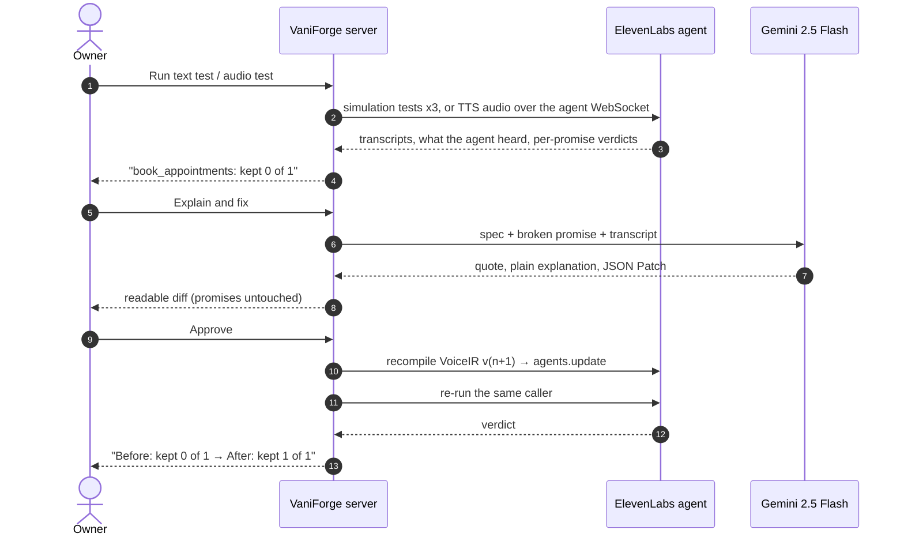

## Product tour

<table>
  <tr>
    <td width="50%">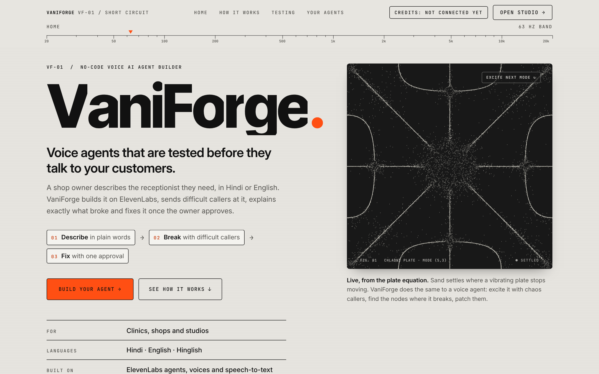<br><sub><b>Landing.</b> The live Chladni plate: sand settles on the lines where the plate stops moving, the way VaniForge finds where an agent breaks.</sub></td>
    <td width="50%">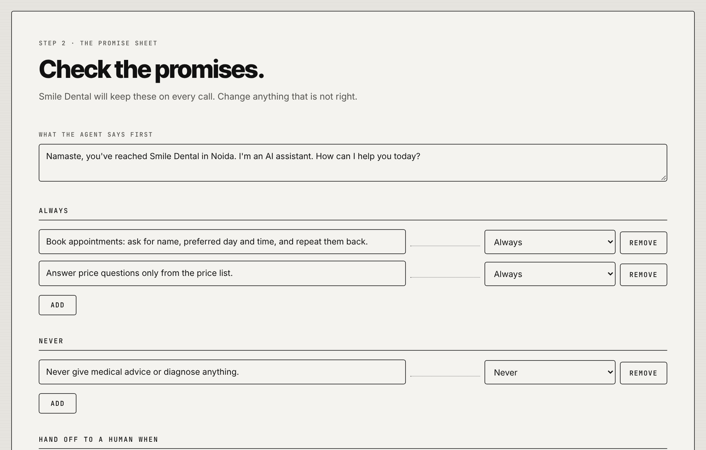<br><sub><b>Promise sheet.</b> The owner's rules in plain words, editable before anything is created. The first message must say it is an AI.</sub></td>
  </tr>
  <tr>
    <td width="50%">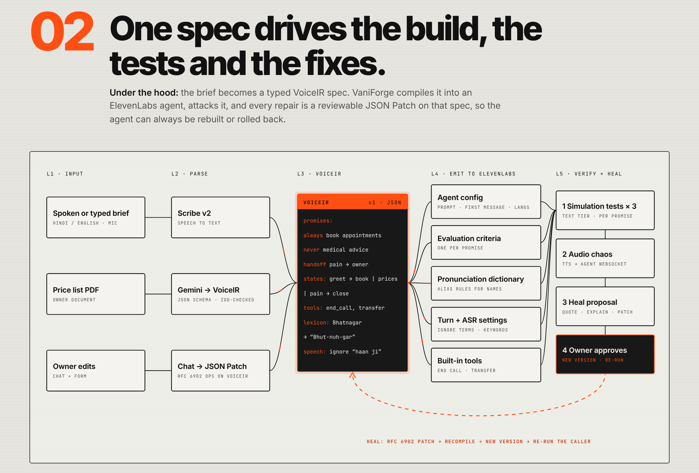<br><sub><b>Under the hood.</b> One spec drives the build, the tests and the fixes; every repair loops back into VoiceIR.</sub></td>
    <td width="50%">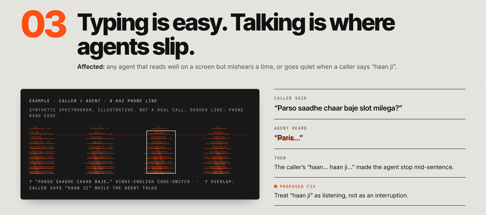<br><sub><b>Why audio.</b> A labelled illustration of a mishearing that text simulations never show.</sub></td>
  </tr>
  <tr>
    <td width="50%">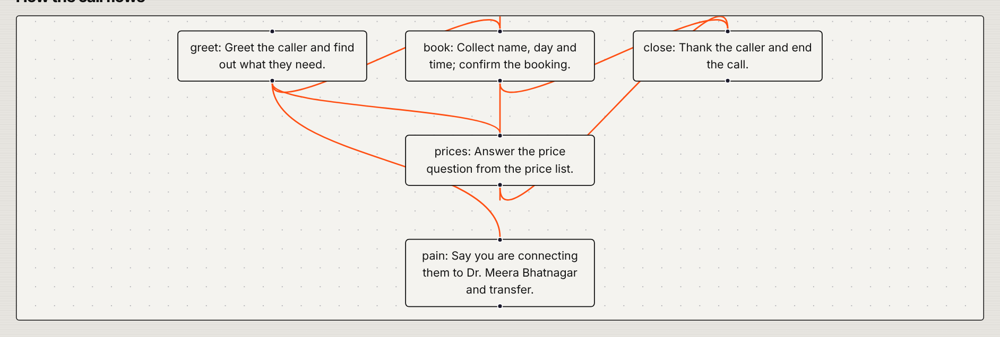<br><sub><b>Studio · Refine.</b> The conversation flow drawn from the spec, next to chat-to-patch, a form editor and version undo.</sub></td>
    <td width="50%">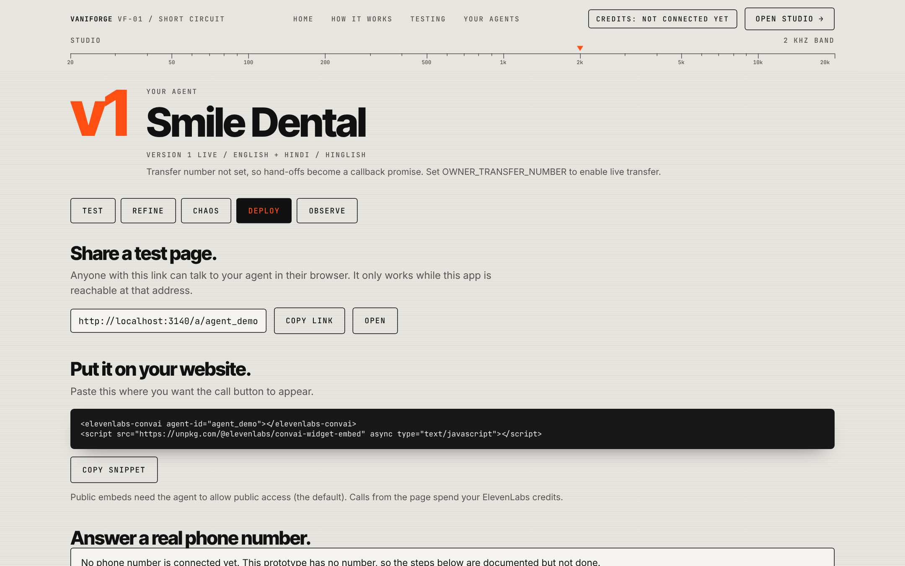<br><sub><b>Studio · Deploy.</b> Share link, embed snippet, and documented Twilio / Exotel phone steps.</sub></td>
  </tr>
  <tr>
    <td width="50%">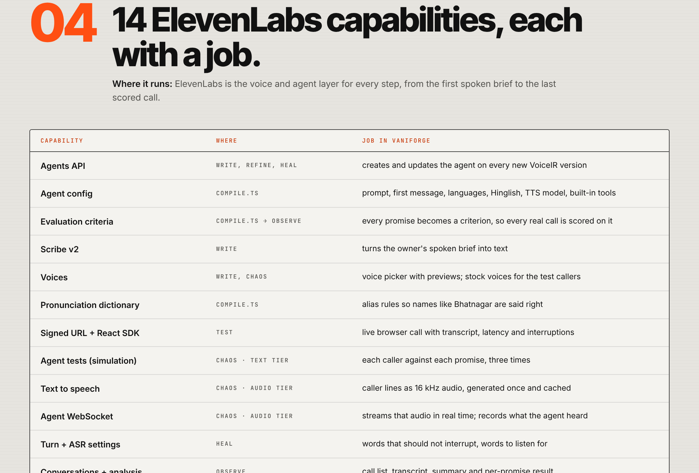<br><sub><b>ElevenLabs inside.</b> Every capability the code uses, and its job.</sub></td>
    <td width="50%" align="center">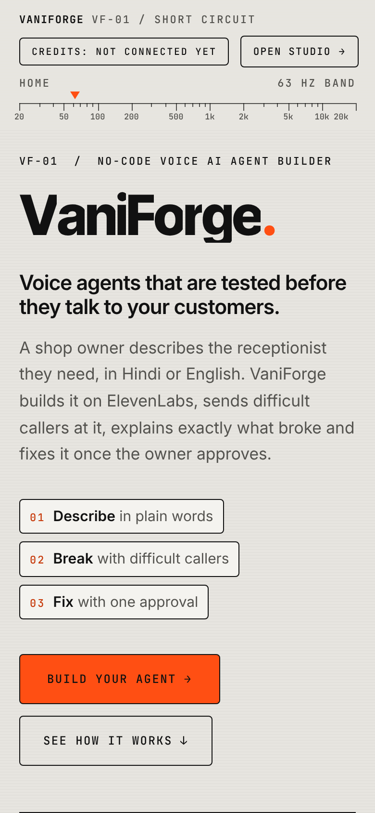<br><sub><b>Phone layout.</b> Every screen works at 390 px.</sub></td>
  </tr>
</table>

<sub>Screenshots are from the production build. They were taken without API keys, so live-only features (credit balance, voices, calls) show their honest "not connected yet" state. No result in them is invented.</sub>

## Architecture

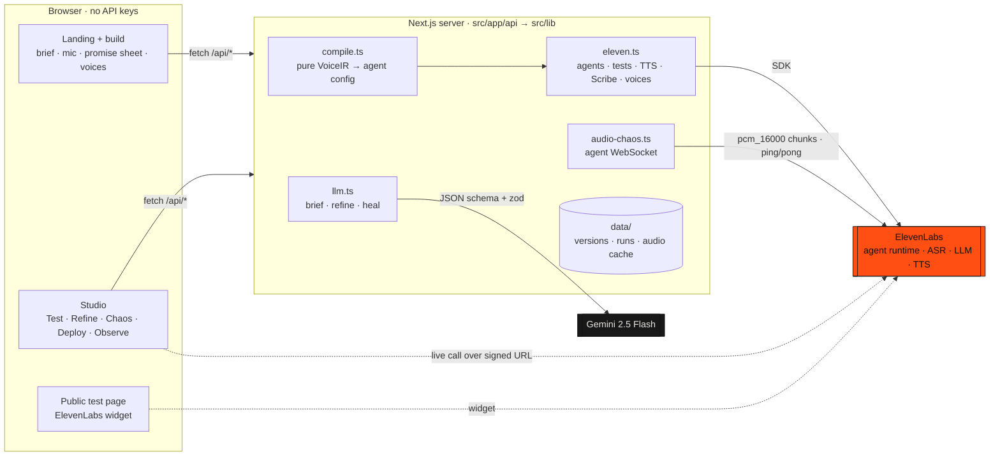

**Design principles**

- **One spec, one compiler.** `VoiceIR` (`src/lib/voiceir.ts`) is the single source of truth. `compile()` is a pure function (no network, no env, no clock), so it is unit-tested without keys.
- **Every change is a patch.** Refine and heal emit RFC 6902 ops. They are applied to a copy, re-validated, saved as `vN.json`, and undoable.
- **The LLM builds; ElevenLabs talks.** Gemini only writes and fixes the spec, at build time. Live conversations never depend on it.
- **Safety in the schema.** The AI disclosure is a schema rule. `/version` and `/tools` are unpatchable. Heal cannot touch the owner's promises.

## Live results

First run against live ElevenLabs and Gemini on **29 Oct 2026** (Creator tier). Every number below was **measured**, not estimated. The full checklist is in [`VERIFY.md`](VERIFY.md).

| Check | Result |
| --- | --- |
| Brief → promise sheet on `gemini-2.5-flash` | ✅ AI-disclosing first message, "Bhatnagar" in the lexicon |
| Create agent | ✅ 5 promises as evaluation criteria, pronunciation dictionary, English base + Hindi preset |
| Refine *"make the welcome message shorter and warmer"* | ✅ v2 greets with *"Hi, I'm your AI assistant for Smile Dental. How can I help?"* |
| Text tier (4 callers × 3) | ✅ 27 simulations in **51 s**, both roles in the transcripts |
| Audio tier | ✅ WebSocket protocol and `pcm_16000` work; the agent heard Hinglish and replied in Hindi; TTS cache reused |
| **Fail → patch → pass** | ✅ Elderly caller, `book_appointments`: **kept 0 of 1 on v2 → 1 of 1 on v3** after heal set `turnEagerness: patient` and ignored "haan ji" |
| Heal honesty | ✅ Real quote, valid patch, owner promises untouched |
| Observe | ✅ Call listed with title, summary and all 5 promise scores |

| Operation | Measured ElevenLabs credits |
| --- | --- |
| Full text tier (27 simulations) | ≈ 7,950 |
| One audio-tier caller (30 to 45 s) | ≈ 1,000 to 1,500 |
| Smoke, compile, refine, heal | 0 |

> **Caveats, stated up front:** audio runs use k = 1, so one pass is evidence, not statistics. On the elderly caller the agent still spoke into pauses after the fix. The fast talker still fails `book_appointments`; its heal is deliberately left unapplied so it can be shown live.

## ElevenLabs inside

| Capability | Where | Job in VaniForge |
| --- | --- | --- |
| Agents API (create, update, delete) | `eleven.ts` → `service.ts` | One agent update per VoiceIR version |
| Agent config | `compile.ts` | Prompt, first message, languages, Hinglish mode, language presets, TTS model per language, max duration |
| Built-in tools | `compile.ts` | End call; transfer to number (only with `OWNER_TRANSFER_NUMBER`); language detection |
| Evaluation criteria | `buildEvaluationCriteria` | Every promise is scored on every real call |
| Scribe v2 | `/api/transcribe` | Spoken brief → text |
| Voices | `/api/voices` | Picker with previews and use-case labels; stock voices for callers |
| Pronunciation dictionary | `service.ts` | Alias rules for names such as Bhatnagar |
| Signed URL + React SDK | `/api/signed-url`, `TestTab.tsx` | Live browser test call |
| Agent tests (simulation) | `text-chaos.ts` | Each caller against each promise, k = 3 |
| Text to speech | `audio-chaos.ts` | Caller lines as 16 kHz PCM, cached forever |
| Agent WebSocket | `audio-chaos.ts` | Real-time audio injection; records what the agent heard |
| Turn + ASR settings | `compile.ts` (Heal) | `interruptionIgnoreTerms`, `turnEagerness`, `asr.keywords` |
| Conversations + analysis | Observe tab | Transcript, AI summary, per-promise verdicts |
| Convai widget | `/a/[agentId]`, Deploy | Shareable page and embed snippet |
| Subscription | header badge | Credit balance and the guard |
| Structured procedures | n/a | **Not used** (roadmap) |

## Quickstart

```bash
git clone https://github.com/Ansh-Goyal01/Vani-Forge.git && cd Vani-Forge
npm install
cp .env.example .env.local      # paste your keys; the file is git-ignored
npm run check-env               # says which vars are set, never prints them
npm run smoke                   # creates and deletes a throwaway agent; places no call
npm run dev                     # http://localhost:3000
```

| Variable | Required | Notes |
| --- | --- | --- |
| `ELEVENLABS_API_KEY` | yes | Server only. The key must allow **Agents (Write), Text to Speech, Speech to Text, Voices (Read), Pronunciation Dictionaries (Write), User (Read)**; the app names any missing permission |
| `GEMINI_API_KEY` | yes | Server only. Use fictional data only: the free tier may train on prompts |
| `GEMINI_MODEL` | no | Default `gemini-2.5-flash`; falls back on 404 |
| `OWNER_TRANSFER_NUMBER` | no | E.164. If empty, hand-offs become a callback promise and are graded that way |

Everything renders without keys, with a clear "add your keys" notice, and all unit tests run without keys.

### Scripts

| Script | What it does | Spends credits |
| --- | --- | --- |
| `npm run dev` / `build` / `start` | Next.js | no |
| `npm run typecheck` / `lint` / `test` | Quality gates (no keys needed) | no |
| `npm run check-env` | Which env vars are set | no |
| `npm run smoke` | Voices → dictionary → throwaway agent → signed URL → balance → delete | no call |
| `npm run seed` | Creates the Smile Dental agent and runs one text-tier pass | simulations |
| `npm run audio-chaos -- <agentId> [caller]` | Audio tier from the terminal; prints *said vs heard* | real call time |

## Repository layout

```text
src/
├─ app/
│  ├─ page.tsx                 landing story + build flow
│  ├─ studio/[agentId]/        Test · Refine · Chaos · Deploy · Observe
│  ├─ a/[agentId]/             public page with the ElevenLabs widget
│  └─ api/                     compile · agents · voices · signed-url · transcribe
│                              chaos · heal · conversations · credits
├─ lib/
│  ├─ voiceir.ts               the spec (zod) + AI-disclosure rule
│  ├─ compile.ts               pure VoiceIR → ElevenLabs agent config
│  ├─ llm.ts                   every Gemini call: schema, retries, fallback
│  ├─ eleven.ts                every ElevenLabs call + permission messages
│  ├─ brief.ts · refine.ts · heal.ts       the three LLM jobs
│  ├─ personas.ts · chaos.ts · text-chaos.ts · audio-chaos.ts
│  ├─ patch.ts · versions.ts   RFC 6902 patches, version history, undo
│  ├─ service.ts · store.ts    glue + JSON-file storage under data/
│  └─ credits.ts · plate.ts    credit guard · Chladni plate maths
├─ components/                 landing, write flow, studio tabs
└─ fonts/                      Inter Tight · Inter · JetBrains Mono (bundled)
scripts/                       check-env · smoke · seed · audio-chaos · make-plate.py
tests/                         11 vitest files, 63 tests, no keys
docs/images/                   README screenshots and banner
```

## Safety, security and cost

- **Keys stay on the server.** They are read only in route handlers and scripts. The browser joins calls with short-lived **signed URLs**; nothing is `NEXT_PUBLIC_`, and nothing is logged.
- **AI disclosure is enforced.** Every first message must say it is an AI, or the spec is invalid.
- **Clinic-safe by default.** A "never give medical advice" promise, pain routed to the owner, and answers only from the owner's facts.
- **Credit guard.** Below **6,500 credits**, live calls and audio tests are refused **server-side**, with an explanation and a demo override. Test calls end at 90 s, and agents are capped at 300 s.
- **No fake data.** Results appear only after real runs; the one illustration on the landing page is labelled as such.
- **Input hygiene.** zod on every request; path-safe ids; size limits on briefs, uploads and audio.

## Quality

- **63 unit tests in 11 files**, all without keys. They cover:
  - the schema and the AI-disclosure rule;
  - the compiler (deterministic, TTS model per language, tools, criteria);
  - patches and undo, and the credit guard;
  - LLM retries, personas and chaos tallies;
  - heal safety, the plate maths and error mapping.
- **Browser QA on the production build** at 1440 / 820 / 390 px, 94 checks covering:
  - every flow, keyboard focus and reduced motion;
  - no console errors and no sideways scroll;
  - **zero layout shift** and 57 to 61 fps on the hero animation.
- Gates before every commit: `typecheck`, `lint`, `test`, `build`.

## Status and roadmap

| Built and verified live | Built, not yet run live | Roadmap only |
| --- | --- | --- |
| Brief → spec, create, refine, text and audio chaos, heal with re-run, Observe, widget page | Live browser call, mic transcription, undo, form editor, seed script | A real phone number (Twilio / Exotel steps documented), structured procedures, Voice Design callers, consented voice cloning, webhook tools, multi-user accounts + database |

## Docs

- [`VERIFY.md`](VERIFY.md): the key-gated checklist, with measured results and costs
- [`DECISIONS.md`](DECISIONS.md): every judgment call, numbered
- [`CLAUDE.md`](CLAUDE.md): the original build brief and design language

<p align="center"><sub><b>VaniForge</b> · VF-01 / Short Circuit · Build Arena 2026<br>Every agent says it is an AI assistant, and only made-up data belongs in it.</sub></p>
